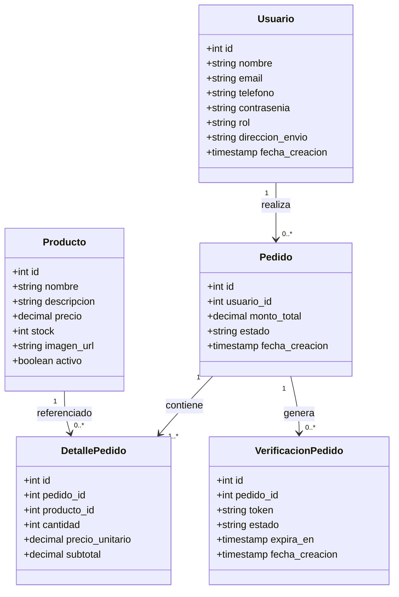
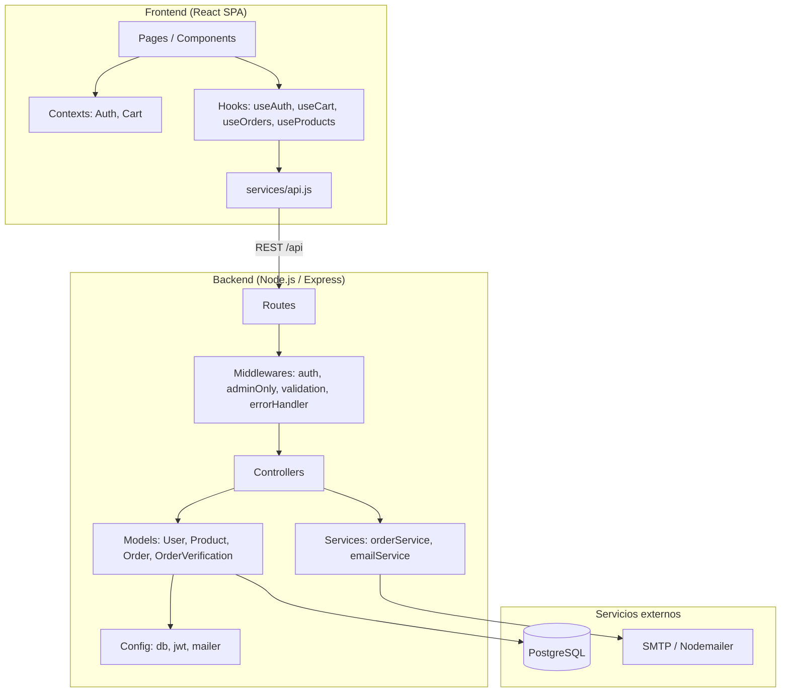

# Diagrama de Clases UML — Proyecto Tienda Steeven

Diagrama de clases del sistema **Tienda Web de Productos Frescos con Confirmación por Correo**.
Refleja el código fuente del backend (Node.js/Express + PostgreSQL) y del frontend (React).

> El diagrama usa sintaxis **Mermaid** (se renderiza en GitHub/Wiki automáticamente).

---

## 1. Diagrama de clases del Backend (Modelos, Servicios y Controladores)

```mermaid
classDiagram
    direction LR

    %% ===== Modelos (acceso a datos) =====
    class User {
        -pool
        +findByEmail(email) User
        +findById(id) User
        +create({nombre,email,telefono,contrasenia,rol,direccion_envio}) User
    }

    class Product {
        -pool
        +findAll() List~Product~
        +findById(id) Product
        +create({nombre,descripcion,precio,stock,imagen_url}) Product
        +update(id,{...}) Product
        +decrementStock(client,productId,quantity) void
    }

    class Order {
        -pool
        +createWithDetails(client,{usuario_id,monto_total,items}) Order
        +findByUser(usuarioId) List~Order~
        +findById(id) Order
        +findAllAdmin(estado) List~Order~
        +updateStatus(id,estado) Order
    }

    class OrderVerification {
        -pool
        -crypto
        +create({pedido_id,ttlMinutes}) OrderVerification
        +findByToken(token) OrderVerification
        +findLatestByOrder(pedidoId) OrderVerification
        +updateEstado(id,estado) OrderVerification
    }

    %% ===== Servicios =====
    class OrderService {
        +processOrderWithEmail(order,user) void
    }

    class EmailService {
        -buildActionUrl(token,action) string
        -buildEmailHtml(order,user,token) string
        +sendOrderConfirmation(order,user,token) Object
    }

    class MailerConfig {
        +transporter
        +mailFrom string
        +mockMode boolean
    }

    %% ===== Controladores =====
    class AuthController {
        +register(req,res,next) void
        +login(req,res,next) void
    }

    class ProductController {
        +list(req,res,next) void
        +create(req,res,next) void
        +update(req,res,next) void
    }

    class OrderController {
        +create(req,res,next) void
        +myOrders(req,res,next) void
        +adminOrders(req,res,next) void
        +despachar(req,res,next) void
    }

    class OrderVerificationController {
        -renderPage({title,message,variant}) string
        +confirm(req,res,next) void
    }

    %% ===== Middlewares =====
    class AuthMiddleware {
        +verifyToken(req,res,next) void
    }
    class AdminOnlyMiddleware {
        +requireAdmin(req,res,next) void
    }
    class ValidationMiddleware {
        +handleValidation(req,res,next) void
        +registerRules
        +loginRules
        +productRules
        +orderRules
    }
    class ErrorHandler {
        +errorHandler(err,req,res,next) void
    }

    %% ===== Config =====
    class DbConfig {
        +pool Pool
    }
    class JwtConfig {
        +secret string
        +expiresIn string
    }
    class Constants {
        +ORDER_STATES
        +VERIFICATION_STATES
        +ROLES
    }

    %% ===== Relaciones =====
    AuthController ..> User : usa
    AuthController ..> JwtConfig : usa
    ProductController ..> Product : usa
    OrderController ..> Order : usa
    OrderController ..> OrderService : invoca
    OrderController ..> DbConfig : usa (transacción)

    OrderService ..> OrderVerification : crea token
    OrderService ..> EmailService : envía correo
    EmailService ..> MailerConfig : usa transporter

    OrderVerificationController ..> OrderVerification : valida token
    OrderVerificationController ..> Order : actualiza estado
    OrderVerificationController ..> Product : decrementa stock
    OrderVerificationController ..> Constants : usa estados

    AuthMiddleware ..> JwtConfig : verifica
    AuthMiddleware ..> User : carga usuario

    User ..> DbConfig : usa
    Product ..> DbConfig : usa
    Order ..> DbConfig : usa
    OrderVerification ..> DbConfig : usa
    Constants ..> Order : define estados
```

---

## 2. Diagrama de clases de Entidades de Dominio (Modelo de Datos)



---

## 3. Diagrama de componentes / capas (Backend)



---

## 4. Notas de diseño

- **Patrón por capas**: Routes → Middlewares → Controllers → Services → Models → DB.
- **Modelos**: objetos con métodos estáticos que encapsulan consultas SQL parametrizadas (previenen inyección SQL).
- **Transaccionalidad**: `OrderController.create` y `OrderVerificationController.confirm` usan transacciones (`BEGIN`/`COMMIT`/`ROLLBACK`) con bloqueo `FOR UPDATE`.
- **Confirmación por correo**: `orderService` genera un token con `crypto.randomBytes(32)` y delega el envío a `emailService`, que soporta modo mock (`MAIL_MOCK=true`).
- **Estados del pedido** (`ORDER_STATES`): `PENDIENTE_VERIFICACION`, `CONFIRMADO`, `CANCELADO_FRAUDE`, `NO_CONFIRMADO`, `DESPACHADO`.
- **Estados de verificación** (`VERIFICATION_STATES`): `PENDIENTE`, `APROBADO`, `RECHAZADO`, `EXPIRADO`.
